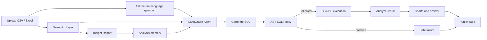

# Nexa

Nexa is a trustworthy AI data analysis workspace. It lets users upload tabular data, ask questions in natural language, and receive SQL-backed analysis, charts, and reproducible evidence for each answer.

The project is intentionally scoped around one hard problem:

> Can an AI data agent produce answers that are safe to execute, traceable, and measurable?

## What Makes It Resume-Worthy

- AST-based SQL safety layer that only allows read-only single-statement queries, blocks DDL/DML operations, applies row limits, and records policy decisions.
- Run-level lineage that preserves the question, schema snapshot, SQL attempts, policy decisions, result samples, retries, errors, and final answer.
- Semantic Layer for governed metrics and dimensions, so the agent can reason with business definitions instead of raw column guesses.
- Governed Insight Report generation that uses only approved metrics and dimensions; without approved definitions it creates a draft data profile instead of inventing business conclusions.
- Auto Investigation workflow that proactively creates Data Detective cards with finding, impact, SQL evidence, confidence, and one-click follow-up questions.
- Hypothesis Engine that turns each finding into testable hypotheses, validation plans, current assessments, and one-click hypothesis checks.
- Decision Brief generation that converts investigations into executive-ready situation, diagnosis, evidence, risk, recommendation, and next-metric summaries.
- Analysis Graph that visualizes the chain from dataset and semantic layer to findings, hypotheses, SQL evidence, and decision brief.
- Metric Contract Check that audits semantic metric/dimension definitions against dataset columns, SQL safety policy, missingness, and answerability gates.
- Analysis memory that injects recent questions and report findings into follow-up analysis, supporting longer-running analysis threads.
- Administrator-controlled local LLM settings for DeepSeek, Kimi/Moonshot, and OpenAI-compatible services without returning API keys to the browser.
- LangGraph agent pipeline with SQL retry separated from system retry, reducing repeated full-pipeline retries and making failures auditable.
- Production-oriented baseline: pytest, frontend lint/build, GitHub Actions CI, Docker Compose, Alembic migrations, route-level code splitting.

## Current Verification Snapshot

These commands were last run locally:

```text
backend pytest: 107 passed
frontend lint: passed
frontend build: passed
```

Offline evaluation on the bundled Superstore suite:

```text
case_count: 12
sql_policy_pass_rate: 1.0
execution_success_rate: 1.0
semantic_accuracy: 1.0
avg_latency_ms: ~3-4
```

The evaluation harness currently uses golden SQL as a deterministic baseline. The next step is to compare real Agent-generated SQL against the same cases.

## Core Workflow



## Trust Architecture

| Layer | Responsibility | Implementation |
|---|---|---|
| SQL safety | Prevent unsafe model-generated queries from reaching execution | `sqlglot` AST inspection in `backend/services/sql_policy.py` |
| Query guardrails | Bound query cost and runaway execution | automatic `LIMIT 10000`, DuckDB interrupt-based timeout, MySQL session timeout attempt |
| Lineage | Make every answer reproducible and auditable | `Run.lineage` JSON and Run History evidence panel |
| Retry control | Avoid duplicating full Agent runs for normal SQL mistakes | graph-level `sql_retry`; controller-level `system_retries` only for thrown system errors |
| Evaluation | Measure changes instead of trusting demos | `backend/evaluation/runner.py` and golden Superstore cases |
| Semantic layer | Stabilize business metric definitions | Metric and dimension APIs in `backend/api/semantic.py` |
| Report generation | Convert analysis runs into reusable deliverables | SQL-backed reports in `backend/services/analysis_reports.py` |
| Analysis memory | Preserve context across follow-up questions and reports | Conversation/report memory injected into chat context |

## Main Features

| Feature | Status | Notes |
|---|---:|---|
| Natural language data analysis | Working | LangGraph pipeline: understand, plan, SQL, execute, analyze, visualize, compose |
| CSV / Excel upload | Working | Preview before upload and DuckDB-backed querying |
| Multi-dataset schema context | Working | Chat can receive multiple selected datasets |
| Data quality gate | Working | Fresh row-count, missing-value, duplicate, negative-value, and schema-drift checks |
| SQL safety policy | Working | AST-based read-only validation, single-statement enforcement, auto-limit, risk flags |
| Run History | Working | Step timeline plus lineage evidence chain |
| Semantic Layer | Working | Auto-seeds conservative suggestions; only SQL-validated, approved definitions enter Agent/report context |
| Metric approval workflow | Working | Approval validates quoted column lineage, SQL policy, dataset ownership, and real execution |
| Insight Reports | Working | Approved definitions produce SQL-backed analysis; ungoverned datasets produce a draft profile marked for review |
| Report publication gate | Working | Requires passing quality, report-snapshot metric approval, and passing metric contracts |
| Auto Investigation | Working | Proactively creates Data Detective cards with finding, impact, evidence, confidence, and one-click follow-up |
| Hypothesis Engine | Working | Converts findings into testable hypotheses with validation plans, assessments, evidence links, and follow-up actions |
| Decision Brief | Working | Turns investigations into executive-ready situation, diagnosis, evidence, risk, recommendation, action, and next-metric summaries |
| Analysis Graph | Working | Visualizes Dataset → Semantic Layer → Finding → Hypothesis → Evidence → Decision Brief lineage |
| Metric Contract Check | Working | Audits metric/dimension definitions for column existence, SQL safety, missingness, and answerability before sharing conclusions |
| Analysis Memory | Working | Uses recent messages and reports as follow-up context |
| LLM Provider Settings | Working | Local administrator can configure DeepSeek/Kimi/OpenAI-compatible endpoints; raw keys are never returned |
| Demo Mode | Working | One-click Superstore project with dataset, semantic layer, and first report |
| Offline evaluation | Working | 12 Superstore cases, expandable to 30-50 |
| Workflow engine | Working MVP | Manual runs bind immutable dataset IDs, execute SQL/Skill steps, and persist status/error lineage; scheduling is not connected |
| Skill system | Working MVP | Four executable manifest-based skills; empty placeholder manifests are hidden and failed steps cannot report success |
| Notebook | Working MVP | Notebook-level dataset binding, governed SQL, and isolated Python subprocesses with a 5-second timeout |
| MySQL | Limited | Session-only table connection, schema/preview/quality/direct SQL; advanced analysis requires an imported snapshot |
| Sharing and roles | Not implemented | No member, role, or read-only link workflow yet |
| Frontend performance | Improved | Route/tab lazy loading and vendor chunk splitting |
| CI | Working | GitHub Actions runs backend tests, frontend lint, frontend build |

## Tech Stack

| Layer | Technology |
|---|---|
| Frontend | React 19, TypeScript, Vite |
| UI | Ant Design, AG Grid |
| Charts | Apache ECharts |
| Backend | FastAPI, SQLAlchemy |
| Agent | LangGraph |
| SQL policy | sqlglot |
| Data engine | DuckDB, Pandas, MySQL connector |
| Persistence | SQLite for local development, PostgreSQL-compatible config, Alembic |
| Auth | JWT, bcrypt |
| Streaming | Server-Sent Events |
| CI | GitHub Actions |

## Quick Start

### Backend

```powershell
cd backend
python -m venv venv
.\venv\Scripts\activate
pip install -r requirements.txt
python main.py
```

Backend API: `http://localhost:8000`

If local requests behave inconsistently after code changes, stop stale dev servers before restarting:

```powershell
netstat -ano | Select-String ':8000|:5173'
Stop-Process -Id <PID> -Force
```

`python main.py` runs Uvicorn with reload enabled, so Windows may show a parent and child Python process. Make sure old listeners are gone before retesting the Superstore demo or Auto Investigation.

### Frontend

```powershell
cd frontend
npm install
npm run dev
```

Frontend: `http://localhost:5173`

### Docker

```powershell
docker compose up --build
```

## Validation Commands

Run these from the repository root:

```powershell
.\backend\venv\Scripts\python.exe -m pytest backend/tests -q
npm run lint --prefix frontend
npm run build --prefix frontend
```

Run offline evaluation:

```powershell
Push-Location backend
.\venv\Scripts\python.exe -m evaluation.runner --format markdown
Pop-Location
```

## Project Structure

```text
Nexa/
  backend/
    agents/          LangGraph pipeline, nodes, controller, tools
    api/             FastAPI routes
    evaluation/      Offline evaluation suites and runner
    models/          SQLAlchemy models
    services/        Auth, run tracking, SQL policy, semantic/report services
    tests/           Backend regression tests
    tools/           DuckDB/MySQL query engines
  frontend/
    src/pages/       App pages including Run History evidence view
    src/components/  Shared UI components
    src/services/    API service layer
    src/types/       Shared TypeScript types
  .github/workflows/ CI pipeline
  docker-compose.yml
```

## Demo Path

1. Start backend and frontend.
2. Click `Try Superstore Demo` on the home page.
3. Open Semantic Layer and review the auto-seeded metrics/dimensions.
4. Open Data and click `Check Data Quality`; resolve blocking issues before sharing conclusions.
5. Open Semantic Layer and approve the metrics/dimensions that match your business definitions.
6. Open Reports, click `Start Auto Investigation`, and review the Decision Brief, Metric Contract Check, Analysis Graph, Data Detective cards, Hypothesis Engine, confidence, SQL evidence, and validation plans.
7. Publish the reviewed report using `Publish Report`.
8. Configure DeepSeek or Kimi in Settings if you want live Chat.
9. Ask: `What is total sales by region?`
10. Open Run History and expand the latest run.
11. Show the evidence chain: schema hash, SQL attempts, policy decision, final SQL, sample rows, answer summary.
12. Run the offline evaluation harness to show objective metrics.

## Development Direction

后续产品与工程开发以 [Nexa 数据工作台开发蓝图](docs/Nexa数据工作台开发蓝图.md) 为基准。文档明确了目标用户、数据工作闭环、核心领域模型、Skill 与 MCP 的职责边界、V1-V3 路线和验收标准，避免围绕零散功能持续堆叠。

## Resume Bullets

- Built a trustworthy AI data analysis agent with LangGraph, FastAPI, DuckDB, and React, enabling natural-language analysis over uploaded datasets with SQL-backed answers and visualizations.
- Designed an AST-based SQL safety layer using `sqlglot`, enforcing read-only single-statement queries, blocking DDL/DML operations, applying row limits, and recording policy decisions for auditability.
- Implemented run-level lineage tracking that captures question, schema snapshot, generated SQL, policy decisions, retries, result samples, and final answer for reproducible analysis.
- Added a governed Semantic Layer, provider settings, demo mode, diagnostic Insight Report generator, Auto Investigation workflow, Hypothesis Engine, Decision Brief, Analysis Graph, and Metric Contract Check, turning uploaded datasets into reusable business metrics, executive-ready briefs, testable Data Detective cards, traceable analysis graphs, answerability gates, one-click follow-ups, and SQL-backed evidence blocks.
- Created an offline evaluation harness with golden SQL cases measuring policy pass rate, execution success, semantic accuracy, and latency, turning prompt/model changes into measurable regressions.
- Hardened engineering baseline with 107 backend tests, frontend lint/build checks, GitHub Actions CI, route-level code splitting, and Alembic migration support.

## Honest Boundaries

Nexa is an actively hardened single-workspace MVP, not an enterprise BI platform.

本项目的真实业务使用复核见：[真实业务使用问题审查报告](docs/真实业务使用问题审查报告.md)。

- The evaluation suite has 12 deterministic golden cases and should be expanded to 30-50 cases.
- Token usage is still estimated, not provider-reported.
- Workflow execution is manual and does not yet support branching, scheduling, or durable resumability.
- Python cells run in a separate process with a timeout, but do not yet have OS/container-level filesystem and network isolation.
- MySQL credentials are intentionally not persisted; connections expire on server restart and advanced analysis requires importing a snapshot.
- Team sharing, roles, read-only links, and approval assignment are not implemented.
- The SQL policy records high-risk patterns like `SELECT *` and joins without conditions, but only blocks clearly unsafe operations today.
- Agent and Skill deadlines are configurable through `LLM_TIMEOUT`, `AGENT_TIMEOUT_SEC`, `SKILL_TIMEOUT_SEC`, and `SKILL_STEP_TIMEOUT_SEC`; provider latency can still affect end-to-end response time.

## Next Roadmap

| Priority | Work | Why |
|---|---|---|
| P0 | Expand evaluation to 30-50 real Agent cases | Measure actual model quality, not only golden SQL execution |
| P0 | Record provider token usage and latency | Make cost/performance claims real |
| P1 | Add SQL dry-run / EXPLAIN checks | Catch expensive or invalid queries before execution |
| P1 | Add demo seed command and hosted demo | Make the project easier to review |
| P1 | Add scheduler and durable workflow workers | Make weekly/new-data automation real |
| P1 | Add organization roles and share links | Support reviewer/publisher workflows safely |
| P2 | Container-sandbox notebook Python | Add filesystem, memory, and network isolation |

## License

MIT
